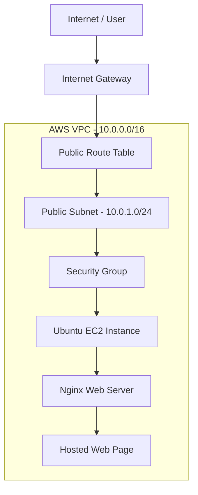

# Terraform AWS Webserver Deployment

## Project Overview

This project demonstrates how to provision and deploy a web server on AWS using Terraform (Infrastructure as Code).

Terraform automatically creates the required AWS infrastructure, launches an Ubuntu EC2 instance, and installs Nginx using a startup script (`user_data`).

The deployed web page displays:

**Hello from Terraform and Ubuntu!**

## Technologies Used

- AWS
- Terraform
- Amazon EC2
- Amazon VPC
- Security Groups
- Internet Gateway
- Ubuntu 22.04
- Nginx
- Linux Bash Scripting
- Git and GitHub

## Architecture



## AWS Infrastructure Created

| Resource | Configuration |
|---|---|
| AWS Region | ap-south-1 (Mumbai) |
| VPC | 10.0.0.0/16 |
| Public Subnet | 10.0.1.0/24 |
| Internet Gateway | Attached to VPC |
| Route Table | 0.0.0.0/0 → Internet Gateway |
| Security Group | SSH (22), HTTP (80) |
| EC2 Instance | Ubuntu 22.04 |
| Instance Type | t3.micro (default) |
| Web Server | Nginx |

## Project Structure

```text
terraform-aws-webserver/
│
├── main.tf
├── vpc.tf
├── ec2.tf
├── sg.tf
├── variables.tf
├── output.tf
├── script.sh
├── .gitignore
├── .terraform.lock.hcl
└── README.md
```

## How It Works

1. Terraform connects to AWS using the configured AWS credentials.
2. It creates a custom VPC and public subnet.
3. An Internet Gateway is attached to the VPC.
4. A route table provides internet routing for the public subnet.
5. A Security Group allows HTTP and SSH traffic.
6. Terraform launches an Ubuntu EC2 instance.
7. The `script.sh` file runs automatically through EC2 user data.
8. The script updates Ubuntu packages and installs Nginx.
9. Nginx starts automatically and serves the custom HTML page.

## Prerequisites

Before deploying this project, make sure you have:

- An AWS account.
- Terraform installed.
- AWS CLI installed and configured.
- Git installed.
- An SSH key pair generated locally.

Generate the SSH key pair in PowerShell from the project directory:

```powershell
ssh-keygen -t rsa -b 4096 -f terraform-webserver-key
```

This generates:
- `terraform-webserver-key` — Private key.
- `terraform-webserver-key.pub` — Public key.

**Never upload your private SSH key to GitHub.**

## Deployment Instructions

### 1. Clone the repository

```bash
git clone https://github.com/Jassi237/terraform-aws-webserver.git
```

```bash
cd terraform-aws-webserver
```

### 2. Initialize Terraform

```bash
terraform init
```

### 3. Validate the configuration

```bash
terraform validate
```

### 4. Review the execution plan

```bash
terraform plan
```

### 5. Deploy the infrastructure

```bash
terraform apply
```

Type `yes` when prompted.

### 6. Get the EC2 public IP

```bash
terraform output instance_public_ip
```

### 7. Access the website

Open the EC2 public IP address in your browser:

```text
http://<EC2_PUBLIC_IP>
```

You should see:

**Hello from Terraform and Ubuntu!**

## Terraform Variables

The project uses a Terraform variable to configure the EC2 instance type.

Default configuration:

```hcl
variable "instance_type" {
  type    = string
  default = "t3.micro"
}
```

You can override the default instance type during deployment:

```bash
terraform apply -var="instance_type=t3.small"
```

## Terraform Outputs

The project provides the following outputs:

- `instance_public_ip` – Public IP address of the EC2 instance.
- `instance_public_dns` – Public DNS name of the EC2 instance.
- `key_name` – Name of the AWS key pair.

View all outputs:

```bash
terraform output
```

## Cleanup

To avoid unnecessary AWS charges, destroy the infrastructure when it is no longer needed:

```bash
terraform destroy
```

Type `yes` to confirm.

## Security Notes

- Never upload private SSH keys or Terraform state files to GitHub.
- Keep AWS credentials outside the repository.
- Restrict SSH access to your own public IP address instead of allowing access from `0.0.0.0/0`.
- Keep `.terraform/`, `*.tfstate`, `*.tfvars`, and SSH private keys in `.gitignore`.

## Author

**Jaspreet Singh**

GitHub: [Jassi237](https://github.com/Jassi237)

Project Repository: [Terraform AWS Webserver](https://github.com/Jassi237/terraform-aws-webserver)
